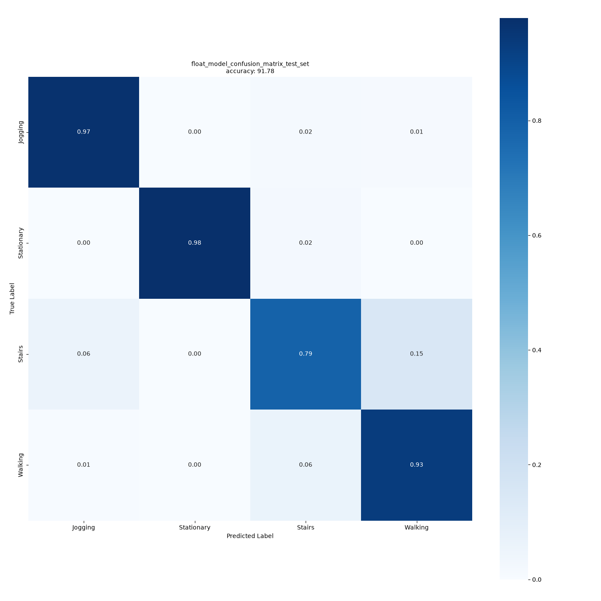

# Результати оцінки моделі

Результати перевірки готової моделі `st_ign_wl_24` з STM32 AI Model Zoo.

Опис моделі та як відтворити ці цифри — у [../README.md](../README.md), параметри для
прошивки — у [../SENSOR_PARAMS.md](../SENSOR_PARAMS.md).

---

## Точність

Обидві оцінки виконані офіційним скриптом `stm32ai_main.py` у режимі `operation_mode: evaluation`.

Це **дві різні натреновані копії** однієї архітектури `st_ign_wl_24` — Model Zoo постачає
окремий файл під кожен датасет. Кожна оцінена на своєму датасеті й своєму наборі класів,
тому цифри не є прямо порівнюваними.

| Датасет | Файл моделі | Класи | Точність | Примітка |
|---|---|---|---|---|
| `mobility_v1` (demo-семпл) | `ST_pretrainedmodel_custom_dataset/mobility_v1/` | Stationary, Walking, Jogging, Biking | **88.83%** | Вбудований у репозиторій підмножинний набір, не повний датасет |
| WISDM (публічний) | `ST_pretrainedmodel_public_dataset/WISDM/` | Jogging, Stationary, Stairs, Walking | **91.78%** | Збігається із заявленим у README моделі |

Для цільового застосування використовується варіант `mobility_v1` (з класом `Biking`).

---

## WISDM — confusion matrix

Рядки — істинний клас, стовпці — передбачений:

| | Jogging | Stationary | Stairs | Walking |
|---|---|---|---|---|
| **Jogging** | **0.97** | 0.00 | 0.02 | 0.01 |
| **Stationary** | 0.00 | **0.98** | 0.02 | 0.00 |
| **Stairs** | 0.06 | 0.00 | **0.79** | 0.15 |
| **Walking** | 0.01 | 0.00 | 0.06 | **0.93** |

Найслабший клас — `Stairs` (0.79): 15% сходів класифікуються як `Walking`, 6% як `Jogging`.
Решта класів мають точність 0.93 і вище.

---

## Важливо про набори класів

Набори класів у двох датасетах різні і не взаємозамінні — через це цифри 88.83% і 91.78%
отримані на різних задачах і не є прямо порівнюваними:

- `mobility_v1`: `[Stationary, Walking, Jogging, Biking]`
- WISDM: `[Jogging, Stationary, Stairs, Walking]`

Наслідки для прошивки (порядок класів, `CTRL_X_CUBE_AI_MODEL_CLASS_LIST`) описані
в [../SENSOR_PARAMS.md](../SENSOR_PARAMS.md#порядок-класів).

---

## TODO / що треба уточнити

- [ ] **Точність 88.83% на `mobility_v1` отримана на demo-семплі**, вбудованому в репозиторій, а не
      на повному датасеті. Повний `mobility_v1` публічно недоступний, тому цю цифру не можна
      напряму порівнювати із заявленою в README моделі. Уточнити, чи потрібна оцінка на повному
      датасеті і чи є до нього доступ.
- [ ] **Квантування не виконувалось.** У Model Zoo для `st_ign` доступний лише формат `.keras`
      (FLOAT32) — готових `.tflite` / int8 варіантів немає. Уточнити, чи потрібен int8 і який
      бюджет RAM/Flash під модель.
- [x] ~~**Версії оточення не зафіксовані.**~~ Зафіксовано в [`../requirements.txt`](../requirements.txt).
      Залишається відкритим інше: це оточення новіше за те, що офіційно підтримує репозиторій
      (`tensorflow==2.18.0`, Python до 3.12). Працює, але офіційно не перевірене — за потреби
      повної відповідності треба зібрати venv на Python 3.12 з офіційними пінами.
- [ ] **Збірка `pesq` на Windows.** Пакет потрібен лише для use-case speech enhancement, але
      блокує імпорт для HAR. Уточнити спосіб обходу (Build Tools або виключення цього імпорту).
- [ ] **Поведінка на одному вікні не описана.** Вікно 24 відліки — це приблизно 0.92 с; наскільки
      стабільне рішення на окремому вікні і чи потрібне згладжування по кількох послідовних
      вікнах — треба виміряти на реальних даних.
