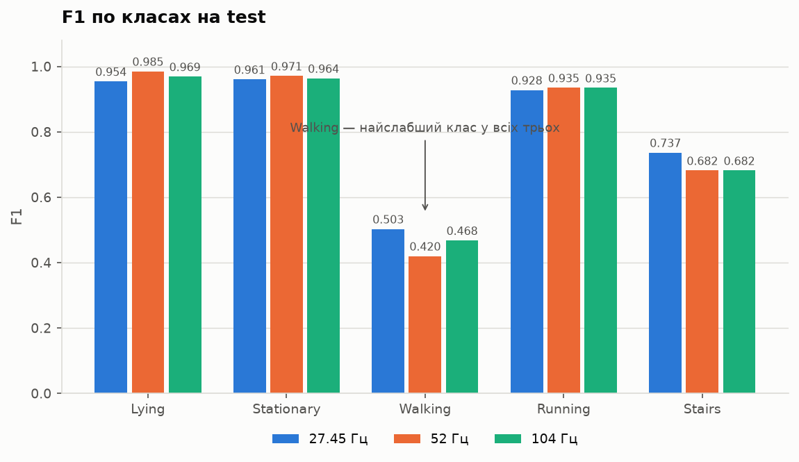
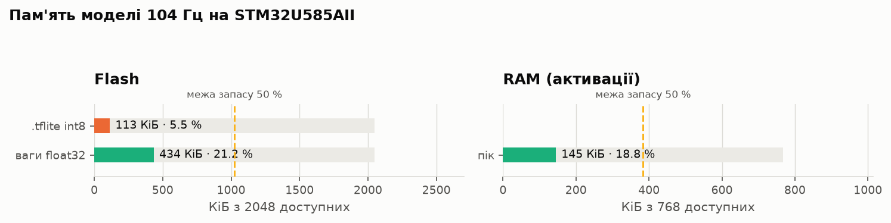
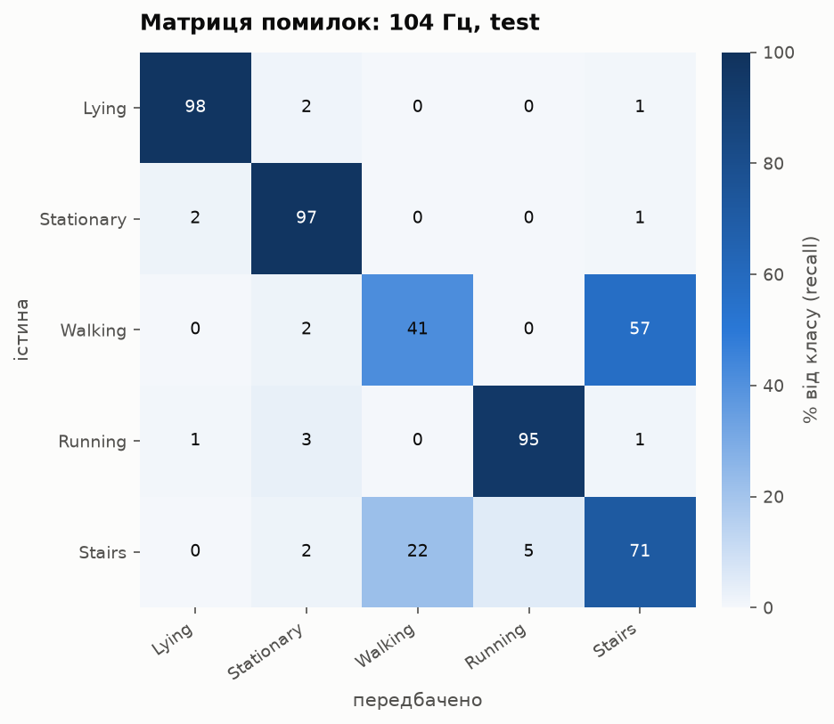
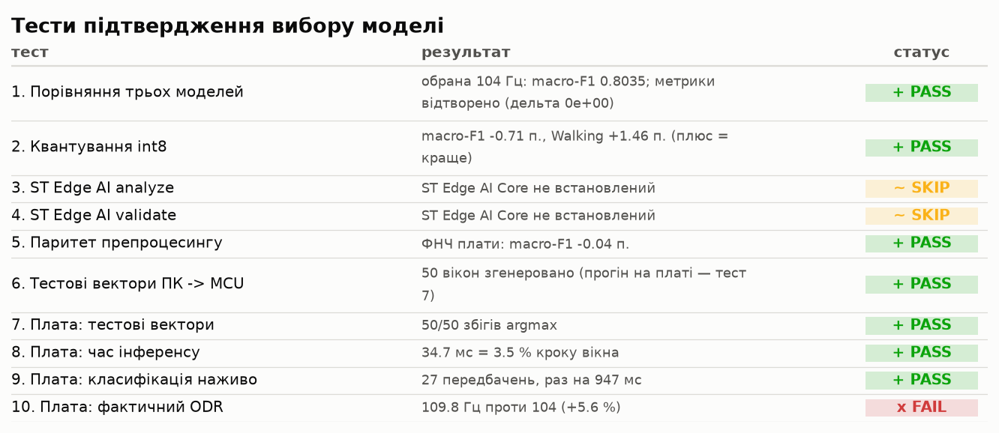
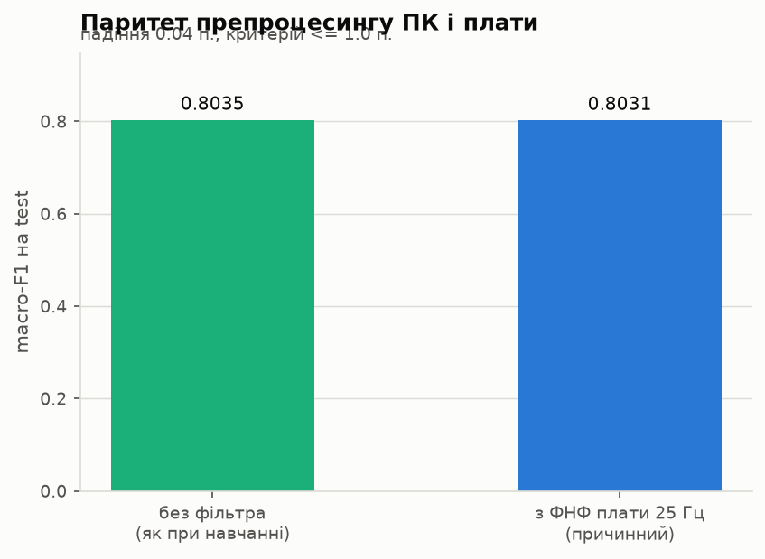
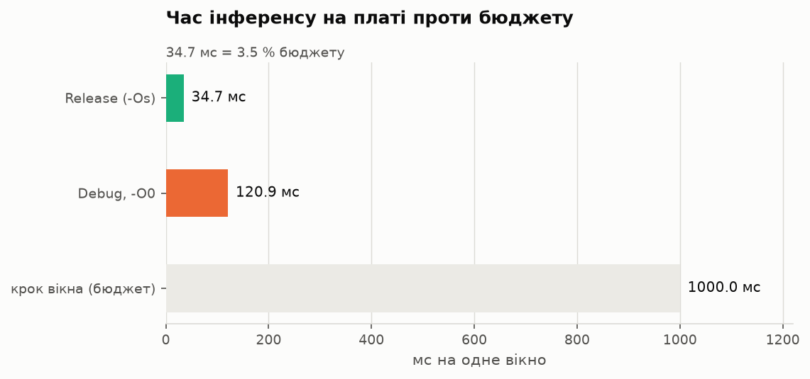

# Підтвердження вибору моделі для деплою на STM32

Усі числа тут отримані `validation/run_all.py` і лежать у
[`results/`](results/). Відтворити: `python validation/run_all.py`
(див. [README.md](README.md)). Прогін займає близько 30 секунд.

## 1. Мета

Обрати одну модель для деплою на плату STM32U585AII і довести, що вибір
витримує перевірку. Порівнювалися три навчені моделі архітектури ST-IGN, які
відрізняються лише частотою дискретизації навчальних даних:

| модель | дані | вхід |
|---|---|---|
| `st_ign_realworld_imu_27hz` | 52 Гц, передискретизовані вниз до 27.45 Гц | 55 × 6 |
| `st_ign_realworld_imu` | 52 Гц | 104 × 6 |
| `st_ign_var2_104hz` | 104 Гц (`har-dataset_var2`) | 208 × 6 |

Критерії вибору: точність на test, сумісність із конфігурацією плати,
обчислювальна вартість і пам'ять, відтворюваність метрик.

Спліт у всіх трьох — строго за людьми: train 1-5, 7-9, 11, 13; val 6, 10;
test 12, 14, 15. Відбір моделі під час навчання йшов лише по `val_loss`
(`ModelCheckpoint`, `EarlyStopping`, `ReduceLROnPlateau`), test оцінювався один
раз наприкінці, тож витоку немає.

## 2. Результати порівняння

| | 27.45 Гц | 52 Гц | **104 Гц (обрана)** |
|---|---|---|---|
| macro-F1 test | **0.8166** | 0.7987 | 0.8035 |
| accuracy test | 0.8375 | 0.8195 | 0.8195 |
| macro-F1 val | **0.8086** | 0.7733 | 0.7657 |
| параметри | 22 949 | 50 597 | 111 077 |
| MACC на вікно | 114 684 | 255 228 | 555 324 |
| ваги float32 | 90 КіБ | 198 КіБ | 434 КіБ |
| RAM під активації | 30 КіБ | 66 КіБ | 145 КіБ |
| сумісність із платою | ні | ні | **так** |


Ранжування однакове на val і на test, тож це не артефакт тестової вибірки.
Передискретизація вгору до 104 Гц дала +0.5 пункта проти 52 Гц, але коштує
вдвічі більше обчислень — і все одно поступається 27-герцовій моделі.



Walking — найслабший клас у всіх трьох моделей. Решта класів тримається на
0.93-0.99, тобто вся похибка зосереджена в парі Walking ↔ Stairs.


Розкид між учасниками помірний (0.74-0.88), аномального учасника немає.

## 3. Чому обрано `st_ign_var2_104hz`

**27-герцова модель точніша, але на цій платі не відтворюється.** Її навчальні
дані отримані `scipy.signal.resample_poly` із 52 Гц, тобто з поліфазним
антиаліасинговим фільтром. Щоб повторити це на платі, довелося б або поставити
ODR 26 Гц і покластися на внутрішній фільтр датчика — а це інший фільтр, — або
семплити вище й децимувати власним фільтром у прошивці. Додатково: при 27.45 Гц
частота Найквіста 13.7 Гц, тож наявний ФНЧ 25 Гц втрачає сенс і весь фільтровий
тракт треба проєктувати заново. Це окрема інженерна робота, а не «взяти готову
модель».

**104-герцова модель узгоджена з платою по всьому тракту.** Константи прошивки
(`Core/Inc/har_model_config.h`) звірені автоматично — тест 1 читає заголовок і
порівнює з очікуваним:

| | плата | модель |
|---|---|---|
| ODR | 104 Гц | 104 Гц |
| вікно | 208 × 6 | 208 × 6 |
| крок | 104 | 104 |
| ФНЧ | 25 Гц, Баттерворт 4-го порядку | навчена на даних із того самого джерела |

Ціна вибору — 1.3 пункта macro-F1 відносно 27-герцової моделі.

**Ресурси не обмежують.** 434 КіБ Flash і 145 КіБ RAM проти 2048 і 768 доступних;
після квантування в int8 — 113 КіБ Flash.





У матриці видно головну ваду: 36 % вікон Walking класифікуються як Stairs.

## 4. Результати тестів підтвердження



| # | тест | критерій | результат | статус |
|---|---|---|---|---|
| 1 | Порівняння трьох моделей | метрики відтворюються; обрана сумісна з платою | дельта 0e+00 на всіх трьох | PASS |
| 2 | Квантування int8 | macro-F1 ≤ 1.5 п., Walking ≤ 3 п. | −0.71 п., Walking **+1.46 п.** | PASS |
| 3 | ST Edge AI analyze | запас ≥ 50 % Flash і RAM | інструмент не встановлений | SKIP |
| 4 | ST Edge AI validate | збіг argmax 100 % | інструмент не встановлений | SKIP |
| 5 | Паритет препроцесингу | падіння macro-F1 ≤ 1 п. | −0.04 п. | PASS |
| 6 | Тестові вектори ПК ↔ MCU | 50 вікон, самоузгоджені | 50 вікон, по 10 на клас | PASS |
| 7 | Плата: тестові вектори | ≥ 98 % збігу argmax | **50/50 = 100 %** | PASS |
| 8 | Плата: час інференсу | істотно менше кроку вікна | **34.7 мс** = 3.5 % від 1000 мс | PASS |
| 9 | Плата: класифікація наживо | модель видає клас | 27 передбачень, раз на 947 мс | PASS |
| 10 | Плата: фактичний ODR | 104 Гц ± 2 % | **109.8 Гц (+5.6 %)** | **FAIL** |

`pytest validation/tests` — **24 пройдено, 1 провалено, 4 пропущено**.

### Тест 2: квантування int8

PTQ на 300 вікнах із train. macro-F1 падає з 0.8035 до 0.7964 — 0.71 пункта при
дозволених 1.5. F1 Walking не просів, а навіть піднявся з 0.468 до 0.483.
Розмір `.tflite` — 113 КіБ проти 434 КіБ ваг float32.


### Тест 5: паритет препроцесингу

Плата проганяє потік через причинний ФНЧ 25 Гц (`har_preproc.c`), а навчальні
дані такого фільтра не бачили — у пайплайні датасету антиаліасинг робився
нульфазовим `filtfilt` і лише для записів, швидших за 1.2 × 50 Гц. Тест міряє
ціну цієї розбіжності: вікна test склеюються в неперервні сегменти, фільтруються
тими самими коефіцієнтами SOS, що зашиті в `har_model_config.h`, і ріжуться
наново — так само, як це робить плата.

macro-F1 0.8035 → 0.8031. Розбіжність реальна, але коштує 0.04 пункта.



### Тест 6: тестові вектори

50 вікон (по 10 на клас) у [`test_vectors/`](test_vectors/): `.npz` для ПК,
C-заголовок для прошивки, `expected.csv` для перегляду. Вектори вже
нормалізовані й подаються прямо в модель, минаючи `har_preproc` — так
перевіряється саме C-модель. Інструкція прогону — у
[test_vectors/README.md](test_vectors/README.md), критерій на платі ≥ 98 % збігу
argmax.

### Тести 7-10: на реальній платі

Прошивка зібрана в CubeIDE (Release, `-Os`) і залита через `STM32_Programmer_CLI`.
Самоперевірка після старту проганяє 50 тестових векторів і міряє час інференсу
лічильником тактів DWT. Сирі логи — у [`board_logs/`](board_logs/), показники —
у `results/board_*.json`.

Модель на платі розгорнута **власною C-реалізацією у float32**, а не через
ST Edge AI Core: хмарний генератор коду не віддавав архів, а локальний інсталятор
не працює. C-код звірений із Python **на всьому тестовому наборі** — 11 841 з
11 841 вікон дають той самий клас, максимальна різниця ймовірностей 1.7·10⁻⁶.
Це сильніша перевірка, ніж `validate` від ST, який звіряє кілька вікон.



Оптимізація `-Os` дала 3.5-кратне прискорення проти Debug (`-O0`: 120.9 мс) і
знизила втрату відліків із 12 до 3 на секунду. Втрати виникають тому, що інференс
блокує головний цикл — за 34.7 мс встигає прийти близько чотирьох відліків.


**Єдиний провалений критерій.** ISM330DHCX іде на 5.6 % швидше за номінал:
замовлені 104 Гц дають 109.8. Те саме відхилення виміряне й незалежно — на
номінальних 26 Гц плата видає 27.45 Гц. Наслідок: вікно з 208 відліків триває
**1.89 с замість 2.00 с**, тобто модель бачить динаміку, стиснуту в часі на 6 %.
Для статичних класів це нешкідливо (Lying розпізнається з імовірністю 0.97), але
для ходьби й бігу зсуває частоти кроку.

## 5. Дефект у `ml/har/data.py`

`model_meta.json` обраної моделі записує джерело даних так:

```json
"repo": "https://github.com/alinaytsk/har-realworld-dataset",
"commit": "6f24dcd14a23003fffe7f2d72e03c49f4af2a11c"
```

Це 52-герцовий датасет, на якому модель із входом 208 × 6 навчена бути не могла.
Причина: `DATASET_REPO` і `DATASET_COMMIT` у `ml/har/data.py` захардкоджені, а
`train.py` копіює їх у метадані незалежно від фактичного `dataset.data_dir`
(у конфізі цієї моделі — `data/har_var2`). Відтворити прогін за метаданими
неможливо.

Виправлені метадані з фактичним джерелом і sha256 файлів датасету —
[`results/model_meta_corrected.json`](results/model_meta_corrected.json).

Як полагодити: `train.py` має писати фактичний `data_dir` і хеші файлів, а не
константи модуля. Мінімальна правка — передавати `cfg["dataset"]["data_dir"]`
у метадані й рахувати sha256 трьох `.npz`.

## 6. Відомі обмеження

**Walking ↔ Stairs.** Головна вада в усіх трьох моделях: F1 Walking 0.468,
recall 0.415 — 1040 з 1834 вікон ходьби класифікуються як сходи. Загальна
accuracy 0.82 це приховує. Без окремої роботи над цією парою трекер
плутатиме ходьбу зі сходами більш ніж у третині випадків.

**ST Edge AI Core не встановлений**, тому реальні Flash/RAM/MACC і звірка
C-моделі з оригіналом не зроблені. Мої оцінки пам'яті — аналітичні.

**Розбіжність частоти.** Фактичні 109.8 Гц проти номінальних 104 — єдиний
провалений критерій, і він не усувається кодом: це властивість датчика на цій
платі. Або номінал треба підібрати так, щоб фактична вийшла 104 Гц, або
перенавчити модель на виміряних 109.8 Гц.

**Інференс блокує збір відліків.** 34.7 мс обробки коштують трьох втрачених
відліків на секунду. `har_preproc` добиває їх інтерполяцією, але краще винести
інференс так, щоб він не конкурував із перериваннями DRDY.

**Не перевірено на живому сигналі.** Лишається один тест:

| тест | критерій | навіщо |
|---|---|---|
| запис Walking і Stairs на плечі | F1 на реальних даних не нижче ніж на test | на датасеті ця пара вже найслабша; треба знати, як вона поводиться на живому сигналі, а не на записах RealWorld |

## 7. Наступні кроки

1. Узгодити частоту: або підняти номінал так, щоб фактична вийшла 104 Гц, або
   перенавчити модель на виміряних 109.8 Гц.
2. Записати реальні Walking і Stairs на плечі й подивитися на цю пару.
3. Винести інференс так, щоб він не блокував збір відліків.
4. Встановити ST Edge AI Core і перезапустити `run_all.py` — тести 3 і 4
   стануть PASS без правок коду.
5. Полагодити запис метаданих у `ml/har/data.py`.

Повне обґрунтування вибору з графіками — у
[model_selection_report.pdf](model_selection_report.pdf), 9 сторінок.
